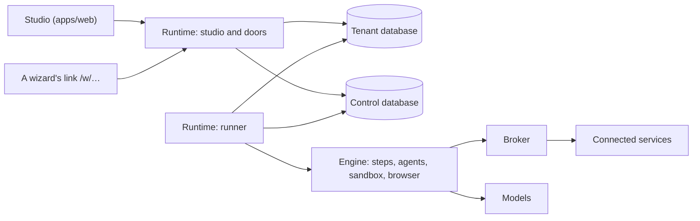

engenty wizards is one server program, the **runtime**, and one web app, the **studio**, that it
serves. The same code runs on your computer and in the cloud. This page shows the parts and how
they fit, with the folder each one lives in.

## The parts

| Part | Folder | What it does |
|---|---|---|
| Runtime | `apps/runtime/src` | The server: the API, the step runner, the databases, the models, the broker, the plugins |
| Studio | `apps/web/src/studio` | Where people build wizards, and where Work mode lives |
| Runner pages | `apps/web/src/runner` | What a person sees at a wizard’s link: its pages, its chat, the result |
| Shared | `packages/shared/src` | The wizard definition and its validator, the words the runtime and the studio share, the feature switches |
| `@engenty/wizards` | `packages/wizards` | What code outside the repository imports: the plugin SDK, `@engenty/wizards-runner`, the OpenUI parts |
| Modules | `modules/` | Plugins that ship with the runtime |

## Roles of the runtime

The runtime reads `RUNTIME_ROLE` at start. It says which half of the routes the process serves
and whether it takes runs.

| Role | Serves |
|---|---|
| `studio` | The makers’ half: sign-in, `/api/studio`, the authoring MCP server (`/api/mcp`), the sync from computers (`/api/v1`), `/install.sh`, the studio’s pages |
| `doors` | The customers’ half: `/api/public`, shared results, the plugins’ public routes and webhooks, `/embed.js`, the pages `/w/<token>` and `/s/<token>` |
| `web` | Both halves |
| `runner` | Takes the runs that wait and drives them. It serves the routes too, for what only the process holding a run can answer, such as its browser’s screen |
| `all` | Everything in one process. The default |

Every role serves what both halves need: `/api/health`, `/api/config`, the runs’ API
(`/api/runs`) and the OAuth callback (`/api/connect`).

The queue of runs is the control database. A runner claims a run in one statement that also
counts the tenant’s running runs against its limit, and writes a heartbeat while it drives the
run. When a runner falls silent, another takes its runs over. Runners register in the control
database’s `runner` table, and `RUNNER_URL` says where the web reaches one.

## Your computer and the cloud

| | On your computer | In the cloud |
|---|---|---|
| Processes | One, role `all`, on `127.0.0.1:24368` | `studio`, `doors` and `runner` from one image, plus a Chromium container that holds no secrets |
| Tenants | One, `local` | One per organization |
| Databases | `tenants/local.db` and `control.db` in the data folder | One libSQL database per tenant and a control database |
| Files | `objects/` in the data folder | An S3-compatible bucket |
| Sign-in | A one-time link the command line opens | The Manage-App’s tokens (OAuth 2.1 / OIDC), which name the person, the tenant and the role |
| Models | An AI client on the computer (Claude Code, Codex, Antigravity, Cursor Agent), your own API keys, a local model, or a linked account’s credits | The model gateway. The runtime holds no model keys |

The **Manage-App** runs engenty’s accounts, organizations, plans and credits, and the **model
gateway** serves the model classes in the cloud. Both are separate apps, not part of this
repository. A runtime talks to them when `MANAGE_URL` and `GATEWAY_URL` are set. Without them it
runs alone, as on your computer.

A computer signed in to an account keeps its spaces in step with the organization in the cloud
([Spaces in the cloud](../user-guide/cloud-sync.md)). What it publishes runs in the cloud, where
its links work while the computer is off.

## Tenants and spaces

A **tenant** is an organization’s data: its own database, its files and its plugins’ tables. The
runtime sets the tenant once per request, run or background job (`tenants/tenant.ts`), never
from a request body. The control database holds what spans tenants: the sessions, the index of
runs, the runners.

A **space** lives inside a tenant. It holds what its wizards share and produce: info and brand,
knowledge, data, files, results, skills and connections. Every AI step knows its space. The
tenant tables carry a `space_id`, and the code says “space” throughout (`services/spaces.ts`).

Each tenant also has a live feed (`live_change`): numbered writes to what a studio shows. An open
studio reads it and shows what changed elsewhere without a reload (`apps/runtime/src/live/`).

## The engine

A wizard is one JSON document ([The wizard format](./wizard-format/index.md)). The step runner
(`engine/runner.ts`) walks it like a cursor: it shows pages, runs AI steps, goes back, makes a
step again and follows branches.

| Step | Runs on |
|---|---|
| `page`, `review`, `result` | The runner pages, with what the person entered |
| `agent` | A Mastra agent with the step’s tools (`engine/steps.ts`, `tools/index.ts`): web search and fetch, the browser, the sandbox, HTTP, the space’s knowledge and data, connections, MCP, plugins’ tools |
| `generate`, `widget`, `motion-graphics`, `surface` | The AI SDK’s media calls, the widget bundler and the renderers (`widgets/`, `motion-graphics/`, `render/`) |

A step names a **model class** (`classifier`, `low`, `standard`, `high`, plus `image`, `video`,
`audio`, `speech`), never a model. Which model serves a class is a setting outside the wizard
(`models.ts`).

### Sandboxes

An agent step with the tool `sandbox` runs shell commands and code in a sandbox. Each run gets
its own, made on first use and thrown away when the run stops (`engine/resources.ts`).

| Engine | What it is |
|---|---|
| `docker` | One container per run through the host’s Docker, from the `engenty-sandbox` image (`SANDBOX_IMAGE`) |
| `agentos` | One VM per run in a helper process, with no Docker: a Linux userland compiled to WebAssembly, Node and Python 3.13. No native programs such as ffmpeg. `wizards sandbox add` installs it. It reaches the npm and PyPI registries and the hosts in `SANDBOX_ALLOW_HOSTS` |

`SANDBOX` picks the engine: `docker`, `agentos`, `off`, or nothing for the first one that is ready.
`SANDBOX_GUESTS` picks the engine for a guest’s run, one that nobody signed in for: `off` (the
default) or `agentos`, never Docker. With `off`, a guest’s run has no sandbox. A member’s run and
a Work chat use the server’s engine.

## Skills

A skill is a folder in the Agent Skills format, kept in the space. A step reads an always-on skill
with every prompt and an on-demand one through a tool when its description fits. Where the skill
may run scripts and the step has the sandbox, its folder goes into the sandbox. [Skills](./skills.md)
has the format, the tools and the routes.

## Plugins

A plugin adds tools for AI steps, routes with tables of their own and pages in the studio. The
runtime finds plugins in its folders at start and again while it runs: the ones in `modules/`,
the folders in `PLUGINS_DIR`, then the ones installed on this runtime. A plugin reaches a connection only
through `server.connections.call`, which goes through the broker as its caller.
[Plugins](./plugins/index.md) explains how to write one.

## The broker

Every call to a connected service goes through one function, `brokerCall`
(`apps/runtime/src/broker/call.ts`): from a wizard step, a Work chat, Goose, a share target or a
plugin. It reads the account’s secret (nothing else does), decides allow, ask or deny, runs the
action and writes one line of the log. Model calls don’t pass it.

- **Connections belong to the space.** A connection signs in as the space or as each person,
  is open to admins, members or everyone, and has a rule for each kind of action: read, write,
  delete, send.
- **A run’s grant** is fixed when the run is created, from the definition it starts on: the
  connections, actions and hosts its steps name. An edit never widens a run under way.
- **RWX rules** per space say who may read, write and execute which document, table, page or
  other resource. Unset means deny, and a deny wins.
- **The log** keeps every call. The critical lines reach the admins under the bell in Work.

[The broker](./broker.md) has the details. The studio shows all of it under
[Capabilities](../user-guide/capabilities.md).

## Work mode

Work mode has chats with the space’s AI (`services/work-chats.ts`, `services/work-ai.ts`,
`apps/web/src/studio/work/`). A chat is a Mastra memory thread in the tenant’s database: the
thread is the chat, the resource is the space. A turn of the space’s AI gets the space’s tools:
its knowledge, its skills, the chat’s sandbox, the connections open to the person who asked, the
plugins’ tools and the web. A tool that acts outside the space doesn’t run when it is called. The
call is held until a person approves it, on every model, also on an AI client that runs the tools
itself.

Each chat gets its own sandbox on its first command. It stays while the chat is in use, so a file
one turn writes is there for the next, and goes after 30 minutes without a command.
[Work mode](../user-guide/work-mode.md) shows it from the person’s side. It is behind the
`workMode` switch.

## Feature switches

Parts that ship in the code but are not on for everyone yet sit behind a switch
(`packages/shared/src/feature-flags.ts`). The runtime asks `feature("name")`, the studio
`useFeature("name")`. A switch gets its value from four layers, the last one winning:

1. The default the code declares, and each plugin’s switches under its id.
2. The `FEATURES` environment variable: `workMode=on,goose=off`.
3. The Manage-App, for the organization in the cloud or the account a computer is linked to.
4. The `.features` file: `~/.engenty/wizards/.features` on your computer, the repository’s root
   in a checkout, the data folder in the cloud. Same shape as `.env`: one `name=on` or
   `name=off` per line.

The runtime reads the file on every call, so a change counts at once. `wizards features` lists
what counts on a computer.
