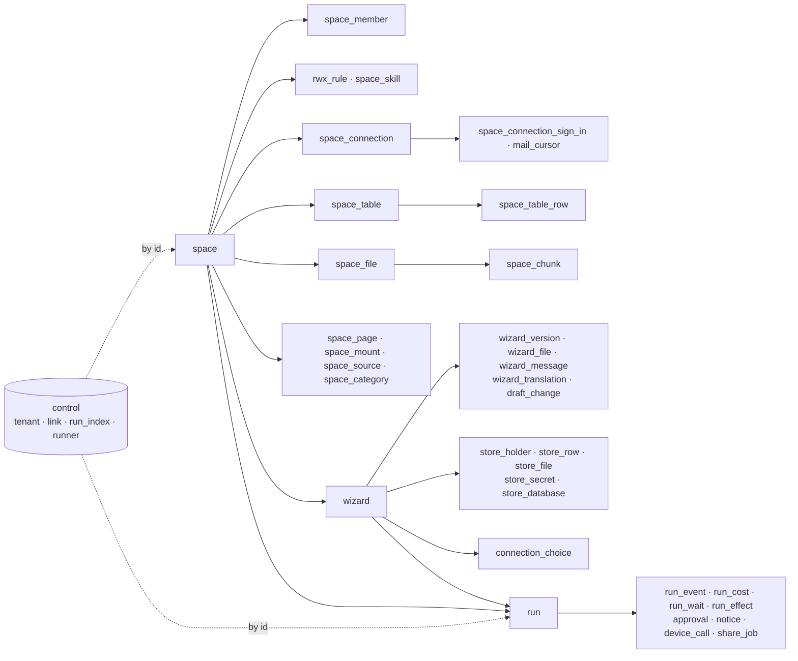

Every tenant has a database of its own and its own folder in the file store. One control database
per runtime holds what spans tenants. [Tenant isolation](./architecture.md#tenant-isolation)
explains the rules. This page lists what each place holds.

## Where data lives

| Store | On your computer | In the cloud | Holds |
|---|---|---|---|
| Control database | `control.db` in the data folder | `DATABASE_URL` | Tenants, public tokens, the index and queue of runs, runners, sessions, settings |
| Tenant database | `tenants/local.db` in the data folder | The address the Manage-App hands out, else `TENANT_DB_URL_TEMPLATE`, else `tenants/<id>.db` | Everything of one organization: spaces, wizards, runs, knowledge, connections, sync |
| A wizard’s own database | `tenants/<tenant>/data/<id>.db` in the data folder | With `TENANT_DB_URL_TEMPLATE`, a database beside the tenant’s, named `<tenant>-<id>` | What a wizard keeps: one per person who runs it, or one shared by every run of its space |
| File store | `objects/` in the data folder | An S3-compatible bucket | Run assets and blobs by hash, under `t/<tenant>/` |

All databases are libSQL, reached through Drizzle (`apps/runtime/src/db/client.ts`). A database
in a file opens with WAL, a busy timeout of 5 seconds and foreign keys on. Code reaches a
tenant’s tables only inside `inTenant()`. Outside it, `db` throws `NoTenantError`.

## The control database

The schema is `apps/runtime/src/db/control-schema.ts`, with 11 tables. They hold what the runtime
knows before a tenant’s database opens. The queue of runs is this database: a runner claims a run
in one statement that also counts the tenant’s running runs against its limit.

| Table | Holds |
|---|---|
| `tenant` | Every tenant this runtime has opened. An empty `db_url` means a libSQL file in the data folder |
| `link` | Public tokens that arrive without a session: which tenant, and which row there |
| `run_index` | One row per run: its tenant, a visitor’s runs across wizards, the runs that are working, `wake_at`, the claim’s `generation` |
| `runner` | The runners that drive runs, where the web reaches each one, and their heartbeat |
| `session` | A studio session of someone signed in at the Manage-App. The refresh token is encrypted |
| `setting` | Settings of a runtime that runs alone: model bindings, the linked account. Never secrets |
| `ui_translation` | The runner’s own words in a language it doesn’t ship, translated once |
| `marketplace_cache` | Starters the marketplace exports, kept for use offline |
| `plugin_job` | When a plugin’s job (`server.every`) last ran for a tenant |
| `plugin_address` | The part of a plugin’s public address that names the tenant without giving its id away |
| `plugin_claim` | Keys a plugin holds across tenants, each for one tenant at a time |

## A tenant’s database

The schema is `apps/runtime/src/db/schema.ts`, with 63 tables. A space lives inside a tenant and
holds what its wizards share and produce. Most tables carry `space_id` or hang off a wizard or a
run.

| Group | Tables | Holds |
|---|---|---|
| Spaces and people | `space` | Name, brand, facts, themes, access, its `kind` (space, client, personal) and its parent |
| | `space_member` | Who is in a space: `member`, one of the organization’s people, or `client`, one of a client’s people |
| | `person_seen` | When a person was last in the app and last opened Work’s bell |
| | `setting` | The organization’s settings: `models`, with its own keys sealed, and each person’s places |
| Wizards | `wizard` | Title, its space, the published version, sharing, limits, starts, the signal token |
| | `wizard_version` | A published version’s files |
| | `wizard_file` | The draft’s files: widget code, libraries, reference data. The bytes are in the blob store |
| | `wizard_message`, `draft_change` | The chat that builds a wizard, and the changes to a draft for the studio’s open tabs |
| | `wizard_translation` | A wizard in one viewer’s language, shared by every version |
| | `asset`, `marketplace_star` | Files a run’s steps made, and the marketplace entries starred here |
| Runs | `run` | One run: wizard, version, grant, who started it, `status`, `cursor`, `state`, `wake_at`, cost |
| | `run_event`, `run_cost` | The run’s log per step, and what each step cost in credit micros |
| | `run_wait`, `run_signal` | A run that waits for a signal, and the signals that came, written before they are matched |
| | `run_effect` | What a run did outside, by the call that asked, so a retry doesn’t act twice |
| | `approval`, `notice` | A review held for named people, where the first decision counts, and a word to a person |
| | `device_call`, `share_job` | A run’s prompts answered by a person’s phone or Mac, and results sent to a share target |
| Knowledge and data | `space_page` | A page: title and markdown, with sub-pages for long documents |
| | `space_table`, `space_table_row` | A table’s columns, and its rows as cells by column id |
| | `space_file`, `space_chunk` | Logos, assets and documents (bytes by hash), and the index of Knowledge |
| | `space_mount`, `space_mount_file`, `space_mount_unit`, `space_mount_draft` | A file tree of another place shown under Dateien, its files, its index and its unpublished edits |
| | `space_source`, `space_source_entry`, `space_source_run` | A source that fills the space, what it holds, and each run of it |
| | `space_category`, `space_category_value`, `space_item_category` | Categories, the values a choice has met, and a category set on one item |
| | `space_skill` | Instructions in the Agent Skills format that the space’s wizards follow |
| Connections and the broker | `space_connector`, `space_bundle` | A service imported as a connector, and a plugin bundle taken into a space |
| | `space_connection`, `space_connection_sign_in` | A space’s connection with its audience and rules, and a person’s own sign-in to it, sealed |
| | `person_connection`, `connection_choice` | A person’s own account from a run, and which connection a wizard uses for one need |
| | `mail_cursor` | How far a mailbox was read |
| | `rwx_rule` | Who may read, write or execute what in a space. Unset means deny, and a deny wins |
| | `broker_log` | Every call that reaches outside: who, where, which action, what was decided |
| A wizard’s own store | `store_holder` | A wizard and a person that stored something. `used_at` drives the clean-up |
| | `store_row`, `store_file` | Rows of a wizard’s lists, and the files it keeps (bytes in the blob store) |
| | `store_secret` | A kept browser session, encrypted |
| | `store_database` | A wizard’s own database and its migrations |
| Sync and live | `live_change`, `live_presence` | Numbered writes an open studio reads, and who is in a wizard, page or table now |
| | `sync_change`, `sync_base` | Changes of items, and the version both sides last agreed on |
| | `sync_conflict`, `sync_merge` | A merge that waits for the person, and one the sync made by itself, with its undo |
| | `sync_guard` | One row, on while your computer writes what it pulled |
| Studio and clients | `assistant_chat`, `assistant_message` | Goose’s chats in the studio, per person |
| | `mcp_app_seen`, `mcp_app_check` | What an AI client did with the MCP server, and the calls the model policy allowed or refused |

### Mastra’s tables

A `durable` agent step keeps its conversation in Mastra’s own store, in the same database
(`engine/durable-turn.ts`, a `LibSQLStore` named `wizard-steps`). Drizzle doesn’t know these
tables.

| Tables | Holds |
|---|---|
| `mastra_workflow_snapshot`, `mastra_workflow_run_owners` | A durable step’s snapshots |
| `mastra_threads`, `mastra_messages`, `mastra_resources` | Nothing. Migration 0080 dropped them with Work’s old chats. The store makes them again, empty, when a durable step first runs |

## How the main tables hang together

An arrow points from parent to child, from `references()` in the schema. The control database’s
`run_index` and `link` name a tenant’s rows by id only. There is no foreign key from one database
to another.

- `run_signal` has no parent. A signal is matched to rows in `run_wait` by its name and key.
- `space_item_category` points to exactly one of a page, a table row, a table, a file and a
  mounted file.
- `space_page` and `space_table` may also name the wizard that made them.

## Migrations

Drizzle keeps the migrations per database, in `apps/runtime/src/db/migrations`.

| Database | Folder | Migrations | When they run |
|---|---|---|---|
| Tenant | `tenant/` | 81, `0000` to `0080` | When a tenant’s database opens: for every organization in the cloud, and on your computer after an update |
| Control | `control/` | 17, `0000` to `0016` | Once at the start of the process, before any tenant opens |

The last tenant migration is the tenant schema’s version. The two-way sync runs only between a
computer and the cloud with the same one.

A wizard’s own database has its own migrations: the wizard’s `data.schema`, then its
`data/migrations/*.sql` in the order of their names (`store/data.ts`).

## What wizards.bot keeps

A Bot Server ([wizards.bot](./packages.md#wizardsbot)) keeps its own data in its own folder. The
studio’s data is never copied there. A Bot Server reads a space through `/api/mcp` on each call,
as the person a turn is for, and the runtime checks the space and its rules every time.
