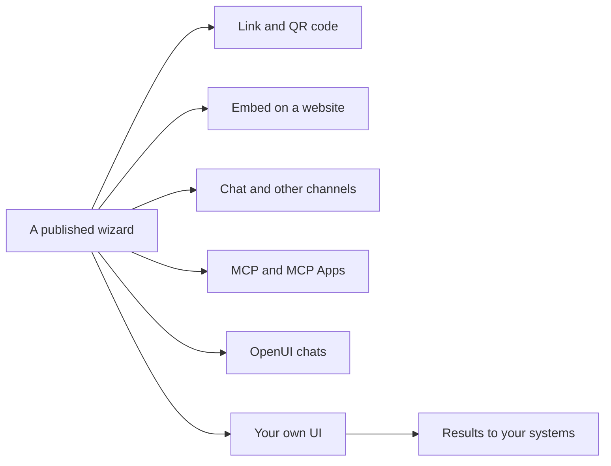

A published wizard runs wherever a person can reach it. These pages show how to bring it into
other systems, from a plain link to a chat that starts the wizard by itself.

## For people

| | |
|---|---|
| [Link and QR code](./link-and-share.md) | The wizard’s own page, as a link or a QR code |
| [Embed](./embed.md) | The wizard on your website, inline, as a button or a chat |
| [Channels](./channels.md) | Page by page or as a chat, and channels of your own |

## For AI apps

| | |
|---|---|
| [MCP](./mcp.md) | AI apps list, run and build wizards over the Model Context Protocol |
| [MCP Apps](./mcp-apps.md) | AI apps that support MCP Apps show the wizard itself, page by page |
| [Claude Code plugin](./claude-code-plugin.md) | The `/wizard` command and the skills to build and use wizards |
| [Marketplaces](./marketplaces.md) | The plugin for every AI app: how it is built, released and listed |
| [OpenUI](./openui.md) | A chat built with OpenUI runs the wizard inside the conversation |

## For your code

| | |
|---|---|
| [Your own UI](./own-ui.md) | Your app draws the run with `@engenty/wizards-runner` |
| [Results to your systems](./results.md) | What a run produces goes on to your own systems |

Each way starts from a published wizard. [Test and share](../../user-guide/test-and-share.md) in the
user guide explains how you publish one.
