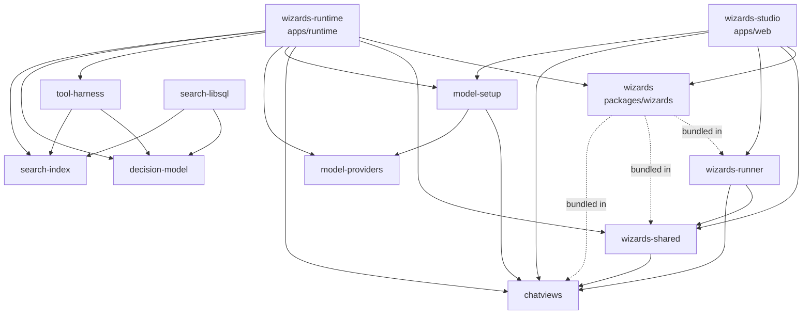

The repository is one pnpm workspace: `apps/*`, `packages/*`, `modules/*` and the examples. It
has 5 apps and 13 packages. Inside the workspace every package is `private` and linked from the
workspace. A release publishes some of them to npm and builds the apps that run in the cloud as
images ([What a release ships](#what-a-release-ships)).

[Architecture](./architecture.md) shows how the parts work together. This page shows where they
are in the code.

## Apps

| Folder | Name | What it is | Ships as |
|---|---|---|---|
| `apps/runtime` | `@engenty/wizards-runtime` | The server: the API, the step runner, the databases, the models, the broker, the plugins. Also the `wizards` command (`src/cli`) | npm, image |
| `apps/web` | `@engenty/wizards-studio` | The web app: the studio with Work and Client, the runner pages, the share page | Inside the runtime |
| `apps/portal` | `@engenty/wizards-portal` | A team’s host at `<team>.wizards.page`: its public pages, and the client portal under `/portal` | Image |
| `apps/sandbox` | `@engenty/wizards-sandbox` | The cloud’s sandbox: agentOS in a container of its own, behind a small HTTP API. One VM per run | Image |
| `apps/docs` | `@engenty/wizards-docs` | This documentation site (Next.js and Fumadocs). Its pages are in `docs/content` | Image |

Two folders outside the workspace belong to it too:

| Folder | What it is | Ships as |
|---|---|---|
| `bin/` | The launcher `npx wizards` runs: it installs the runtime and hands over to it. Also `wizards bot`, which installs and runs a [wizards.bot](#wizardsbot) server on your computer | npm, as `wizards` |
| `modules/` | Plugins that ship with every runtime. It holds none at the moment, only its `README.md` | Inside the runtime |

## Packages

| Folder | Name | What it is | Imported by | Ships as |
|---|---|---|---|---|
| `packages/wizards` | `@engenty/wizards` | What code outside the repository imports: `/plugin`, `/plugin/studio`, `/plugin/thread` and `/openui`. Its build bundles the runner, the views and the shared modules in | runtime, studio | npm, FSL-1.1-MIT |
| `packages/shared` | `@engenty/wizards-shared` | The wizard definition and its validator, `transition()`, the words the runtime and the studio share, the feature switches | runtime, studio, `wizards`, runner | Inside the others |
| `packages/runner` | `@engenty/wizards-runner` | The components that draw a wizard’s run, given a run source | studio, `wizards` | Inside `@engenty/wizards` |
| `packages/chatviews` | `@engenty/chatviews` | Views in a chat and in a wizard: surfaces from a catalogue of components bound to data, their checks and the calc language | runtime, studio, `wizards`, shared, runner, model-setup | npm, MIT |
| `packages/decision-model` | `@engenty/decision-model` | The ways to a decision model: Jev through the Vercel AI Gateway or TypeSafe, or Clef-flash in Ollama | runtime, tool-harness, search-libsql | npm, MIT |
| `packages/search-index` | `@engenty/search-index` | Search contracts: index providers, embedders, chunks and scoring | runtime, tool-harness, search-libsql | npm, MIT |
| `packages/search-libsql` | `@engenty/search-libsql` | A search index on libSQL: full text (FTS5) and vectors, fused by rank, ranked by a decision model | Nothing in this repository | npm, MIT |
| `packages/tool-harness` | `@engenty/tool-harness` | One harness around an agent’s tools: the few it always has, a search for the rest, one call that runs what was found | runtime | npm, MIT |
| `packages/model-providers` | `@engenty/model-providers` | Every way to a model: servers for open models on your computer (Ollama, LM Studio, MLX), AI clients on your subscription (Claude Code, Codex, Antigravity, Cursor Agent), providers you bring a key for (OpenAI, Anthropic, Google, OpenRouter, the Vercel AI Gateway and more) and the wizards account | runtime, model-setup | npm, MIT |
| `packages/model-setup` | `@engenty/model-setup` | The setup where a person picks what an app thinks with, shared by the studio and wizards.bot | runtime, studio | npm, MIT |
| `packages/vault` | `@engenty/vault` | Secrets sealed with AES-256-GCM, key rings, a redactor, what a password vault needs | Nothing in this repository | npm, MIT |
| `packages/plugins` | `@engenty/plugins` | The plugin contract engenty wizards and wizards.bot both load, and a host that runs a plugin’s tools with fewer rights | Nothing in this repository | npm, MIT |
| `packages/browser` | `@engenty/browser` | A browser for agents on Mastra’s agent-browser, with a private fill that types only on the expected website | Nothing in this repository | npm, MIT |

`@engenty/model-providers` was called `@engenty/local-models` up to v0.21.3, and had only the
first two of its four parts then. On npm, v0.21.3 and older have the old name.

The runtime keeps its own `secrets/`, `plugins/` and `browser/` folders. It doesn’t import
`vault`, `plugins` or `browser`: those three are for apps outside this repository, such as
wizards.bot.

### Which package imports which

An arrow means “imports”, from the `dependencies` of each `package.json`.

`vault`, `plugins` and `browser` import none of the others, and nothing here imports them.

## What a release ships

A release tag `v<version>` ships every part at the same version (`scripts/npm-package.mjs`,
`.github/workflows/ci.yml`).

| Where | What |
|---|---|
| npm | `wizards` (the launcher), `@engenty/wizards-runtime` (the runtime with the studio and the modules), `@engenty/wizards`, and the MIT libraries: `chatviews`, `decision-model`, `search-index`, `search-libsql`, `tool-harness`, `vault`, `plugins`, `browser`, `model-providers`, `model-setup` |
| GHCR | `ghcr.io/engenty/engenty-wizards-<image>` for `runtime`, `browser`, `sandbox`, `portal` and `docs` |

[Licensing](./licensing.md) says which licence each part has.

## wizards.bot

wizards.bot ([engenty/wizards-bot](https://github.com/engenty/wizards-bot)) is a repository of
its own. Its Bot Server runs Work’s chats ([Work mode](./architecture.md#work-mode)). It takes
packages of this repository from npm, pinned by release version, never from a folder beside it.

| wizards.bot app | Imports from npm |
|---|---|
| `@wizards-bot/home`, the Bot Server | `chatviews`, `model-setup`, `model-providers`, `tool-harness`, `search-index`, `decision-model`, `vault`, `plugins`, `browser` |
| `@wizards-bot/web`, its web app | `chatviews`, `model-setup` |

So one setup for models and one kind of view serve the studio and the Bot Server. A change to one
of these packages reaches wizards.bot with the next release, once wizards.bot moves up to it. Up to
v0.21.3 it imports `@engenty/local-models` under that name.

## Folders of the runtime

What is where in `apps/runtime/src`:

| Area | Folders | What they hold |
|---|---|---|
| Requests | `app.ts`, `index.ts` | The Hono app and the start of the process |
| | `routes/` | One file per group of routes: studio, work, runs, api, live, connections, plugins, signals, marketplace and more |
| | `auth/`, `tenants/` | Sign-in, and the tenant set once per request (`inTenant()`) |
| | `mcp/` | The MCP server that AI clients and the Bot Server call |
| Runs | `engine/` | The step runner (`runner.ts`), the steps, what a run holds, durable turns, the mail watch |
| | `agents/`, `prompts/` | The runtime’s own agents, such as Goose in a space (`space-agent.ts`), and every instruction a model reads |
| | `tools/`, `harness/` | An agent step’s tools and the harness around them |
| | `sandbox/`, `browser/` | Shell and code per run, and the browser for agents |
| | `widgets/`, `render/`, `motion-graphics/`, `media/` | What the media and widget steps make |
| | `sharing/` | The share targets a result is sent to |
| Outside calls | `broker/` | `brokerCall`: the grant, the RWX rules, allow, ask or deny, the log |
| | `connectors/`, `secrets/` | Imported services and sealed secrets |
| | `elements/` | The tool catalogue: a space’s knowledge, skills, wizards and connections for every AI |
| | `models.ts`, `upstreams.ts`, `local-models.ts` | Which model serves a class, and where it is reached |
| Data | `db/` | Both Drizzle schemas, the clients, the migrations ([Databases](./databases.md)) |
| | `files/` | The file store and blobs by hash |
| | `store/` | A wizard’s own lists, files and databases |
| | `mounts/` | File trees of other places, shown in a space under Dateien |
| | `sync/`, `live/` | Your computer’s spaces in step with the cloud, and the live feed an open studio reads |
| Studio | `assistant/`, `authoring/` | Goose, the studio’s assistant, and the tools that build wizards |
| | `services/` | Spaces, drafts, wizards and what the routes share |
| | `plugins/`, `bundles/`, `documents/` | Plugins loaded at start and while it runs, bundles, reading documents |
| Running alone | `cli/` | The `wizards` command: start, guided setup, status, update |
| | `manage.ts`, `credits/` | What the runtime asks the Manage-App, and credits |
| | `update.ts`, `health.ts` | Updates on your computer, and `/api/health` |
