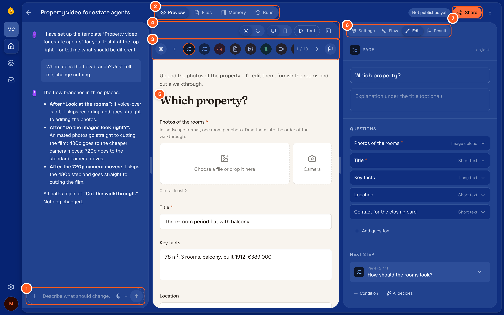

## Start one

“New wizard” on the list of your wizards, or “Add wizard” in the space’s menu, opens the page “What should your
wizard do?”. It gives you three ways in:

| Way | How |
|---|---|
| Describe it | Write what the wizard should do in your own words and click “Build wizard” |
| A template | Choose one under “Or start from a template”. Search, or narrow the list by industry, result and capability |
| A wizard file | “Import a wizard file”, at the foot of the page, takes a `.wizard` file someone exported |

A description that works says who enters what, what the wizard does with it, and what comes out:

> Customers enter their product and audience. The wizard researches competitors and writes a
> positioning briefing as a PDF.

You can change everything afterwards in the chat.

### Before you build

- **How it runs.** “Runs as” above the text field says how people will reach the wizard: as a
  “Step-by-step wizard” unless you choose otherwise. The + beside it asks “How should it run?”
  and lists the other channels this studio offers, for example “Chat”. One channel always stays
  on. The assistant builds the wizard for what you chose.
- **Files.** Attach examples, price lists or screenshots with the + in the text field, or paste
  or drop them there. They go into the wizard’s files, and the assistant looks at them.
- **Dictation.** The microphone button lets you speak instead of type.
- **Similar wizards.** While you type, the page lists up to ten of your own wizards and templates
  that come close. “Open” opens one of yours, and “Use” starts from a template. This way you
  don’t build again what is already there.

### Templates

- A template shows how the wizard runs, how long a run takes, what it costs and what it needs
  before you start from it with “Start with this template”.
- “Not set up here” names a model that isn’t set up on this computer yet, for example for video.
  Set it up under [Models and account](./models.md), or choose another template.
- A template marked “Pro” needs plugins that come with Pro on engenty.ai.
- A star keeps a template on this computer, so you can use it without a connection.
- A wizard started from a template is your copy. Later changes to the template don’t touch it.

## The editor

1. **Chat.** Say what should change. The assistant edits the wizard and tells you what it did.
2. **Preview, Files, Memory, Runs.** Files are what the wizard uses on every run, like price
   lists or widget code. Memory is what it knows across all its runs: notes its AI steps read
   and add to, and its shared lists. Runs are its test runs and live runs.
3. **The row of steps.** The settings (the gear) first, the steps in their order, the result
   (the flag) last. The arrows, or ← and → on the keyboard, move from one to the next.
4. **The preview’s bar.** The wizard’s themes, light or dark pages, its languages, a desk or a
   phone, and “Test”. The button at its end shows or hides the column on the right.
5. **Preview.** The step you chose as people see it, filled with the answers of the latest test
   run, or the test run itself.
6. **The column.** “Settings”, “Flow” (the diagram with its branches), “Edit” (the step you
   chose) and “Result”.
7. **Share.** Publishes the wizard and gives you its link. See [Test and share](./test-and-share.md).

On a smaller window “Flow” is a tab beside “Preview”, and “Preview” and “Edit” switch the main
area between showing the step and editing it. On a phone the chat sits in a sheet over the
bottom: folded it keeps the text field, drag its handle to open it. This holds on any window
narrower than a laptop, a tablet too.

The gear in the row of steps, or a click on the wizard’s name in the top bar, opens its own
settings: its title, description and greeting, its avatar, and the language it speaks to people
in. With “Automatic, from its texts” the wizard speaks the language its texts are written in.

Under “Look” the wizard wears a theme: a look kept in the space, which other wizards of the space
can wear too. Folded, the section shows the theme, a small preview of the wizard’s page and a
line on what the look is; “Adjust” opens the settings. The first change makes a theme named after
the wizard.

| Setting | What it does |
|---|---|
| Theme | Which theme the wizard wears: one of the space’s, the space’s brand, or a neutral look without a brand. It sits above the preview, folded or open |
| Costume | What the wizard’s engenty wears, on its pages and in the theme’s figures |
| Pages | Dark first, light first, dark only or light only. With only one, everyone sees those pages and the theme switch is hidden |
| Colours | Accent, ground and text for dark and for light pages, as small swatches. A dashed one takes the brand’s colour. A click opens the brand’s colours, a colour of your own, and “As in the brand” |
| Font for headings, Font for text | “As in the brand”, or one of the fonts engenty wizards ships, from Inter to the spooky Creepster |
| Shape | Corners (soft, sharp, round), cards (solid, outline, glass) and headings (as written, in capitals) |
| Effects | One row to switch on: glow, fog, spider webs or frost in the corners, embers, snow, confetti or stars, dots or a grid, and figures that wear the wizard’s costume |

A theme two wizards wear changes for both. The section says which other wizards wear it and
offers a copy for this wizard only. A wizard file carries the themes its wizard wears.

The preview wears the wizard’s theme, with its effects. The studio around it keeps its own look.

The assistant sets the look too. Ask it, for example: “Make it dark and spooky for Halloween.”

The ⋯ button in the top bar (“More”) duplicates the wizard, exports it, or deletes it. Only
whoever manages the team can delete a wizard. The same menu is on the wizard’s card in the list.

### In the chat

- Write what should be different: “Ask for the delivery date on the first page”, “Add a review
  before the PDF”.
- Attach files the assistant should look at: an example document, a price list, a screenshot.
- Dictate instead of typing with the microphone button.
- If the connection drops, what was already built is saved. Send your message again.

### Step by step

Open a step from the row of steps or the diagram; a second click on a step in the diagram opens
its editor. What you can set depends on its type: see [Steps](./steps.md).

“Add step” on a step in the diagram, or in a step’s editor, puts a new step after it. Say what it
should do and choose its kind, or leave it to “AI chooses”. Then say when it runs: “Always”,
“Only if…” a condition holds, or when “AI decides…”. “Create” lets the assistant build the step
in the chat. “Insert empty” adds a blank step of the kind you choose, for you to fill in.

## When the wizard needs fixes

A draft may be incomplete while you work on it. Before you test or share, the editor lists what
is missing, for example a step that uses an answer that is only asked later, or a tool that isn’t
installed here. “Let the assistant fix it” hands that list to the chat.

If a step needs a model that isn’t set up here, the editor names the step and the model, and
“Set up models” takes you there. If every path of the wizard needs that model, the wizard can’t
start. If only one branch needs it, choose another path when you test.

## What makes a good wizard

- Write for people who are not technical: use plain words, and phrase titles as questions.
- Keep to few pages, one theme per page and at most five fields. Ask only what the result needs.
- Put a review before anything expensive, such as video, and before the final result.
- Let the phone do the typing: a photo instead of a description, the location instead of an
  address form, a voice note instead of a long text.
- Put money in a line-items field. The wizard works out net, VAT and total itself; a model never
  does.
- Facts from the web need a research step before the step that writes.

## Take it with you

“Export as a wizard file (.wizard)” in the wizard’s ⋯ menu downloads its steps and its files as
one file. “Import a wizard file” on the “New wizard” page of any studio takes it in.
