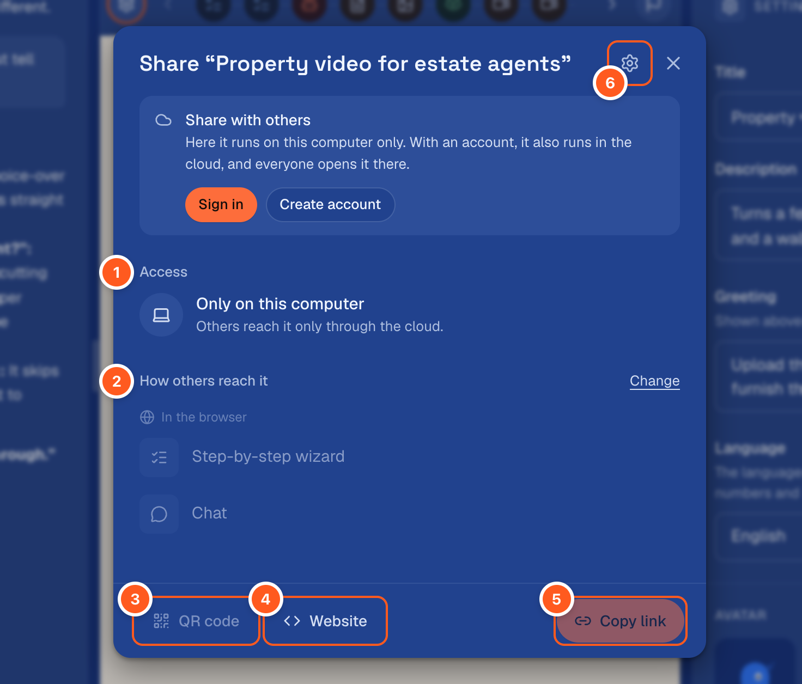

## Test

“Test” in the preview’s bar starts a run of the draft, just as a person would see it, in the
preview. “Test run” at the start of the row of steps comes back to it after you looked at a step.
Test runs are listed under “Runs”. A test spends what a real run spends: your model’s usage, or credits. A test
run reads the wizard’s memory, but it writes into a copy of its own, which goes with the run.

Where runs spend credits, each AI step shows an estimate. At first it is a formula. After five
runs it is measured from the latest ones.

## Publish

A wizard goes live the first time you share it. “Share” publishes the draft as version 1 as the
dialog opens, and the dialog says “Published when you shared it”. Nobody has the link until you hand it
out, and “Only you” under “Access” switches it off. A draft with issues is not published: the dialog lists
what to fix first, with “Let the assistant fix it”.

After that, the editor’s top bar shows “Publish changes” whenever the draft differs from the
version people run. It opens a dialog with these parts:

| Part | Says |
|---|---|
| What changed | The wizard’s own settings, each step by its title (new, removed, or which of its parts changed: fields, instructions, result …), the order of the steps and the files |
| Tested | Whether a test run used exactly this draft: “Tested 4 minutes ago – with these changes” with “See the run”, or “Not tested with these changes yet.” with “Test now” |
| Notes | Anyone in the middle of a run carries on with the version they started. Where the cost changed, it says what a run costs now. With an account, it says that the version also arrives in your account’s cloud |

“Publish” makes the draft the next version, and the link stays the same. Issues stop it, as on
the first share. The editor’s top bar and the wizard’s card on the start page say where it runs:

| It says | Means |
|---|---|
| “Not published yet” in the editor, “Draft” on the card | Only you can run it, as a test. Sharing it publishes it |
| “Live · version 3” in the editor, “Live” on the card | The link runs this version. With a cloud icon, it runs on engenty.ai for everyone with the link |
| “Live · 1 note” | It runs in the cloud, but one step does less there (see “Share”) |
| “Local” | It is published on your computer without an account. The link only answers on this computer, while engenty wizards is running |
| “On its way to the cloud” | The version hasn’t arrived on engenty.ai yet. The studio tries again by itself |
| “Not in the cloud” | engenty.ai runs no version of it. “Share” says why and what helps. If an older version still runs there, the chip shows that version in amber with a crossed-out cloud |

On a card, “Link” copies the address others can open, and the arrow opens it. A wizard that
runs only on this computer has no address for others. Its “Link” says so and explains how an
account gives it one, and the arrow opens it here.

The ⋯ menu on a card and in the editor has “Duplicate”, “Export as a wizard file (.wizard)” and
“Delete”.

## Share

“Share” says who may open the wizard and how others reach it, and it copies the link.



| Part | Does |
|---|---|
| 1 · Access | With “Anyone with the link”, anyone can open and fill it in, up to the runs a day set under “Settings”. “Only you” switches the link off: everyone else sees a notice, and you test in the studio |
| 2 · How others reach it | The ways the wizard runs (see below). Each row copies its own link. “Change” lets you choose them, from the same list as for a new wizard |
| 3 · QR code | One of the links as a QR code to download or print |
| 4 · Website | The code for a website (see below) |
| 5 · Copy link | The link people open. It opens the first way that is on, and the wizard offers the other on its first page |
| 6 · Settings (the gear) | “Limit per day” (50 runs unless you change it, with what that costs at most), “Offer a translation” (a machine translation per language, which you can edit), and “Create a new link”: the old link and its QR code stop working, in the cloud too |

The picture is from a computer without an account: the box at the top offers “Sign in” and
“Create account”, and “Access” says “Only on this computer” (see
[Who can open the link](#who-can-open-the-link)). Where the draft has changes, the dialog says so
at the top and leads to “Publish changes”.

One visitor can start 6 runs an hour.

### Page by page or as a chat

A wizard can run page by page or as a chat. A wizard you start on the “New wizard” page runs step by step unless you choose more under “How
should it run?”. A wizard without its own choice, such as one from a template or an import, has
the step-by-step page and the chat switched on. You can change that later under “Change” in the
share dialog.

The cards on the start page show the ways that are on as small icons, the link’s own first. Once wizards with two or more statuses are in the space, a row of pills above the cards
narrows them to one status: “Draft”, “Local”, “Live” or “Not in the cloud”.

The link opens the first way that is on. The other answers under its own address (`/steps` or
`/chat`) and is offered on the wizard’s first page, for example “Or: Chat”. An address that is switched off sends people to
the link instead.

### Who can open the link

engenty wizards on your computer only answers on `localhost`. The link works on that computer,
not for anyone else. To let others run the wizard:

| Way | How |
|---|---|
| The cloud | Sign in with an [account](./create-account.md). Every version that goes live (the first share, and each “Publish”) then also goes to engenty.ai. Its link there runs on the account’s credits, even while your computer is off |
| Your own server | [Run engenty wizards on a server](./server.md) with a public https address |

### In the cloud

Once you sign in to an account under Settings → Account, your avatar carries a small cloud, and its menu says “Connected to
engenty.ai” with your credits. The share dialog gives the wizard’s address at engenty.ai, which
stays the same when you publish again. Where the cloud doesn’t run this version, the dialog says
so at the top:

| It shows | Means |
|---|---|
| “Version 3 doesn’t run in the cloud.” | Something the wizard needs is missing there. The list says what, and the version before keeps running |
| “Send again” | The last version didn’t arrive, or the space changed. When engenty.ai was the problem, the studio tries again by itself and says when |

Without an account, the dialog says that the wizard runs only on this computer (“Only on this
computer” under “Access”). It greys out the ways others reach it and offers “Sign in” and “Create
account”.

What goes to the cloud and what stays:

| Goes to the cloud | Stays on your computer |
|---|---|
| The published version and its files | Drafts and the chat with the assistant |
| The space’s name, what it says about itself, its colours, facts and logo | Runs and results on your computer |
| The pages and tables of Knowledge, with their categories | What the wizards keep: their lists and notes |
| How the link is shared: on or off, runs a day, page or chat | Connected accounts, keys, the space’s documents and its connected systems |

At engenty.ai/studio you see the space and its runs there. A small laptop icon marks the space,
and a note says “You edit this space in engenty wizards on your computer.” The studio there
doesn’t edit it. An account holds one space from one computer. On a new computer, the share
dialog offers “Replace that space”, which removes the old computer’s wizards and their links from
the cloud.

When you delete a wizard here, its copy in the cloud is deleted too. When you switch its link
off here, it is switched off there as well.

### Embed in a website

Under “Website”, the share dialog gives you code to paste into a page’s HTML. Where the wizard
has both the step-by-step page and the chat on, you first choose what the website shows:

| What does the website show? | Shows |
|---|---|
| Step-by-step wizard | The wizard page by page |
| Chat | The wizard as a chat, 640 px high (`data-height` changes that) |

| Where on the page? | Shows |
|---|---|
| In the page | The wizard in that place on the page, as tall as its content |
| Behind a button | Step by step only: a button in that place that opens the wizard in a window over the page |
| As a chat button | Chat only: the wizard’s engenty in the bottom right corner. The chat opens above it |
| As a bubble | Step by step only: a round button at the bottom right of the page that opens the wizard in a window over the page. It is best put in the site’s footer |

```html
<script async src="https://example.com/embed.js" data-wizard="TOKEN"></script>
<script async src="https://example.com/embed.js" data-wizard="TOKEN" data-mode="modal" data-label="Start"></script>
<script async src="https://example.com/embed.js" data-wizard="TOKEN" data-runner="chat"></script>
<script async src="https://example.com/embed.js" data-wizard="TOKEN" data-mode="popout"></script>
<script async src="https://example.com/embed.js" data-wizard="TOKEN" data-mode="bubble" data-label="Questions?" data-text="A quote in 2 minutes"></script>
```

The dialog gives the code once the wizard is published, open to anyone with the link, and
reachable by others: on your computer that takes an account (see
[Who can open the link](#who-can-open-the-link)). Until then it says so instead. A chat in the
page that is switched off for the wizard shows the step-by-step page instead. The chat button
always opens the chat.

| Attribute | Does |
|---|---|
| `data-label` | The button’s words. Beside the chat button, a short label. For the bubble, its name for screen readers |
| `data-text` | A short line beside the bubble |
| `data-color` | The colour of the chat button and of the bubble |
| `data-height` | The height of a chat in the page, in px |
| `data-page` | The page a run is started on, kept with its result. Without it, the page’s own address is used |
| `data-theme` | Which of the wizard’s themes the website shows: the id of one it wears, `brand` or `default`. Without it, the wizard’s first theme. See [Embed](../dev/integration/embed.md) |

Your website’s own styles reach the button through the class `engenty-wizard-button`, the chat
button through `engenty-wizard-launcher` and the bubble through `engenty-wizard-bubble`. A page
shows only one bubble: a second bubble tag does nothing.

## Results people share

On the result page, a person can share what they got as a link. The result of a run over the
wizard’s link, and the link to it, are deleted after 7 days. The person can withdraw the link
earlier. “Share” also sends the result on – by email, into a cloud folder, to Slack or onto a
website: see [Share a result](./run.md#share-a-result).

## Move a wizard

Export it as a wizard file (`.wizard`) from its ⋯ menu, and import it in another studio. See [Build a wizard](./build-a-wizard.md#take-it-with-you).
