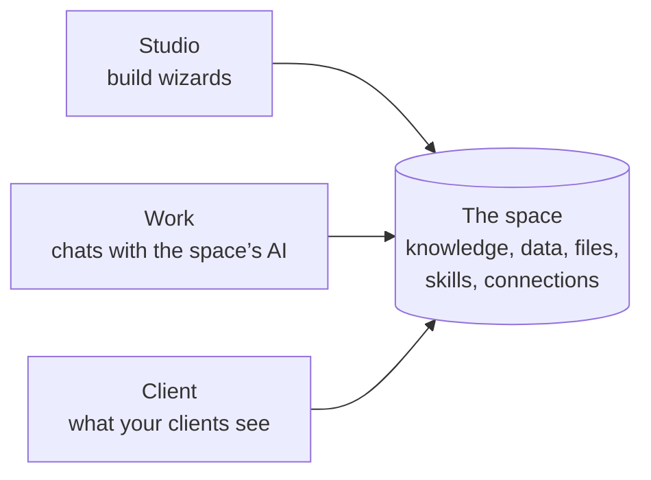
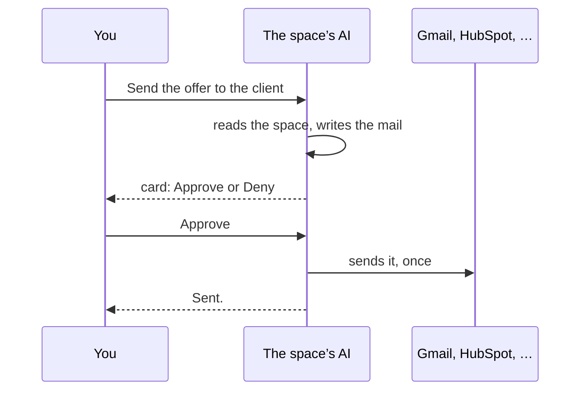

Work mode is where your team works with the space: you write in chats, and the space’s AI
answers with what the space knows. Studio stays where you build wizards.

Work mode is not on for everyone yet. In the cloud, engenty switches it on for an organization. On
your computer you add this line to `~/.engenty/wizards/.features`:

```bash
workMode=on
```

Without it, the studio looks as before: Studio alone, with no switch.

## Studio, Work and Client

The switch sits in the app bar, right under the space. On a phone it sits in the top bar. The
engenty in the bar’s corner shows the mode you are in: green for Studio, blue for Work, violet
for Client.

| Mode | For | What it holds |
|---|---|---|
| **Studio** | The people who build | Wizards, Sources, Capabilities and the settings, as before |
| **Work** | Everyone in the organization | Chats with the space’s AI, and what waits for you |
| **Client** | A look at what your clients see | Nothing yet. “This view comes soon.” |



The owner and the admins see all three. A member sees Work and Client. Where the space’s admins
switched on **Members can use the studio**, members get Studio as well
([Capabilities](./capabilities.md#who-sees-capabilities)). A member who opens a Studio address of
a space that doesn’t let them in lands in Work. The studio remembers your mode in this browser.

## Work’s places

Work’s app bar has Chats, Engenties, Files, Data, Results and **Waiting for you**. Engenties,
Files, Data and Results show nothing yet. You reach the space’s files from a chat.

**Start**, at the top of the chats, greets you and shows:

- **Needs you**: calls waiting for your approval, and chats with something new.
- **Running now**: chats in which the space’s AI is answering.
- **Wizards**: a few of the space’s published wizards. A click opens one in its own chat, in a
  new tab, where it runs. Work’s chats don’t run wizards yet.
- **Recent**: the chats of late.
- A field to ask the space’s AI. It starts a new chat.

## Chats

The sidebar holds a new chat, the search, your pinned chats, the sections, and the chats in no
section. A chat’s sub-threads sit beneath it. From a chat’s row you pin it, archive it, mark it
read or unread, rename it, move it to a section (or drag it there) and delete it. The filter shows
archived chats or unread ones only.

A chat is open to everyone in the organization, who joins it by writing in it. A **private** chat
is seen by its members only.

## Ask the space’s AI

The space’s AI answers under the space’s name. It runs on the same models as the studio’s chat:
in the cloud on the organization’s models, on your computer on the way you chose under
[Studio chat](./models.md#studio-chat-goose).

- Alone in a chat with the AI, every message asks it.
- With more people in the chat, **Ask {space}** above the message box or a message that starts
  with `@` asks it. Other messages are for the people.
- A message you send while the AI answers goes into the answer under way. ⌘↩ (Ctrl+↩ on Windows
  and Linux) sends it for after the answer instead.
- **Stop** ends the answer. Your message stays in the chat.

In the message box’s **+** menu you choose files from the space, switch web search off, leave
out a plugin’s tools, and open one of the space’s wizards. The model menu beside it switches to
the more capable model for the chat. You add up to 10 files to a message. The AI reads pictures
and PDFs itself, and each file you add lands in the space’s files.

An answer may take up to 16 steps and 20 minutes. Under it you see what the AI did: what it
searched in the space and on the web, which skill it read, which commands it ran. **Details**
opens each step with its input and its result. Where a table or a form says more than text, the
AI draws one in the chat. Anyone in the chat may fill in and send a form the AI drew.

## What the AI may use

| | In a chat |
|---|---|
| The space’s knowledge | It searches and reads it |
| [Skills](./skills.md) | It sees the space’s skills and reads one when it helps |
| A computer of its own | It runs commands and the scripts of skills that may run them ([Run a skill’s scripts](./skills.md#run-a-skills-scripts)) |
| [Connections](./capabilities.md#connectors) | The ones open to you. Where each person signs in, only the ones you signed in to |
| Plugins’ tools | Unless you left them out for the chat |
| The web | Unless you switched web search off |

The computer is a sandbox for this chat alone. It starts with the AI’s first command and keeps its
files while the chat is in use, so a file one answer writes is there for the next. After 30
minutes without a command it goes, and its files with it. Where your computer has no sandbox, the
AI runs no commands and reads scripts as text. [`wizards sandbox add`](./command-line.md) adds
one.

## Approvals

Reading and searching run without asking. A call that acts outside the space, such as sending a
mail, changing a record or deleting, waits for approval. The chat shows a card with **Approve**
and **Deny**, and the AI goes on with its answer.

| Who decides | When |
|---|---|
| The person who asked, the owner or an admin | A change through a connection, or a plugin’s tool that acts outside the space |
| The owner or an admin alone | A connection that signs in as the space, where the rule is With approval |

An approved call runs once, with the arguments it waited with, and the AI hears how it went. A
denied call doesn’t run.



**Waiting for you** lists the calls waiting for your approval, each leading to its chat. For the
owner and the admins it also shows the critical lines of the space’s [Log](./protocol.md), such
as a refused change or a connection used for the first time. Opening it marks them seen.

## Client

Client is where you will see the space as your clients see it. It shows a placeholder for now.
