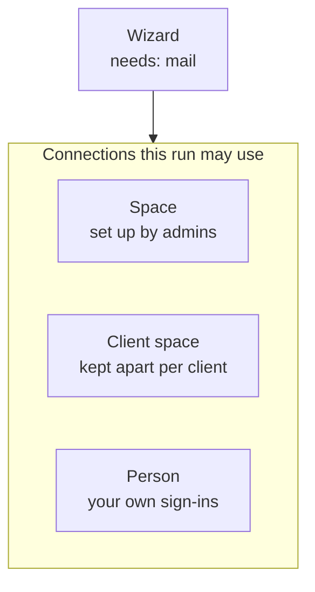
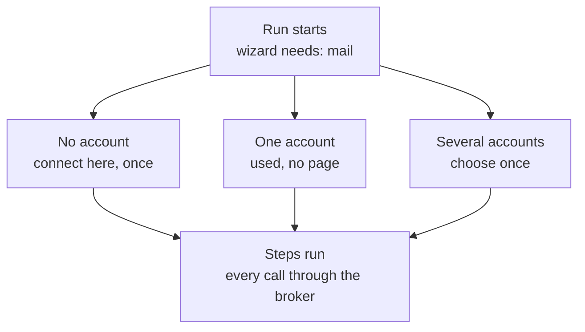
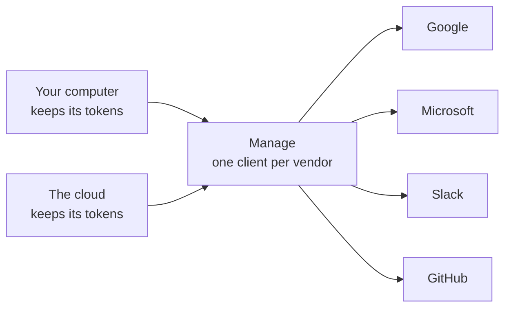

# Plan: connections in a run

Status: planned on 2026-11-14, nothing decided and nothing built. Checked against `main` at
`45491ce9`. Follows `docs/plans/capabilities.md` (the connection model, the broker) and
`docs/plans/integrations.md` (the OAuth clients).

## In short

**The wizard names the service. The run finds the account.**

| Thing | What it is | Today |
|---|---|---|
| Need | The wizard names a service: `kind: "mail"` or `connector: "gmail"` | Exists. `spaceConnection: <id>` also names one account |
| Connection | A signed-in account that belongs to a space, a client space or a person | Three stores |
| Choice | Which connection a wizard uses, remembered | Doesn't exist |

A run that needs an account counts the ones it may use. None: the person connects right there.
One: it is used, with no page. Several: the person chooses once.

## Why

The wish "Connect my Gmail and show me the most important mails from the last 2 days" gives this
today:

- The architect puts a connect field on the first page, beside the other questions
  (`prompts/authoring.md`, the line on the person's mail).
- The page's heading says Gmail and the only button says IMAP. Gmail and Outlook are left out
  where their OAuth client is missing (`usable()` in `connectors/builtin.ts`).
- The account is kept for one wizard and one person (`store_secret`, slot `connection:<id>`,
  keyed by `scopeOf(run)`). The next mail wizard asks again.
- A Gmail the space already has is not offered. A wizard reaches a connection of the space only
  by its id, written into the definition.

## What is built

| Store | Where | How a wizard reaches it |
|---|---|---|
| A wizard's account | `store_secret`, per wizard and person | A page field of kind `connection` |
| A connection of the space | `spaceConnection`, and `spaceConnectionSignIn` where each person signs in | `spaceConnection: <id>` in the definition |
| A person's own sign-ins | `connectors/person-sign-ins.ts`, in no space | Not at all, they are Goose's |

- **The need** is partly read already: `requires.connections` lists a wizard's kinds (`requiresOf`),
  not its connectors.
- **Waiting for a sign-in** works: a step that meets a missing sign-in throws `SignInNeeded`, the
  run waits and goes on by itself after the sign-in (`engine/runner.ts`, `waitForPerson`). The
  person signs in somewhere else, the run's page offers nothing.
- **The check before a run** refuses a start that cannot finish, for models
  (`engine/requirements.ts`). It doesn't look at connections.
- `capabilities.md` planned to move a wizard's accounts into the space's tables. That move has not
  happened.

## The system

### Where connections live

- A connection has one owner: a space, a client space or a person. A guest's belongs to the
  visitor, as today.
- A run sees the connections of the person running it and of the space it runs in. A run in a
  client space sees that client space's, never the parent's or another client's.
- The space's rules stay where they are: who may use a connection, and *Allowed / With approval /
  Never* per kind of action.

### What a run does

- **A choice already made** is used first, as long as its connection still exists and the person
  may still use it.
- **One card, two moments.** At the start the run looks ahead at the steps every run passes and
  asks for what is missing. A need on a branch asks when the run gets there. Both show the same
  connect card (`ConnectionField` in `packages/runner`), and so does a step that waits for a new
  sign-in.
- **Where the person sees it.** „Was dieser Wizard sich merkt“ names the account in use and lets
  the person change it.
- **A new account** belongs to the person who connects it. An admin may connect it for the space
  instead (open question 2).
- **A run nobody watches** (a start, a channel without a browser) uses a connection of the space.
  An admin makes that choice on the wizard's page in the studio. Without it the check before a run
  refuses the start, as it does for a missing model. A call or an SMS hands over a link to the
  connect card, as for any page only the browser shows.
- **The broker** changes nothing. Its rules follow the chosen connection: where it signs in as the
  space, an AI step only reads and a write is a tool step.

### What leaves

| Leaves | Instead |
|---|---|
| The page field of kind `connection`, placed by the architect | The run shows the card by itself |
| `spaceConnection: <id>` in a definition | `connector`, plus the space's choice kept beside the wizard |
| A wizard's own account store (`connection:<id>` in `store_secret`) | A connection of the person |
| The authoring rules on where to put the connect field | One rule: declare the need, list it on the step |

A definition without a connection id runs in any space, also a client space or a template's new
home.

## Order of work

Behind a switch in `.features` (`runConnections`), in small pull requests.

| | Step | Where |
|---|---|---|
| 1 | One store: a wizard's accounts and Goose's sign-ins become connections with an owner. Rows move once by command | `connectors/`, `db/schema.ts` |
| 2 | The lookup: the connections a run may use for a need, and the remembered choice | `connectors/index.ts`, `broker/account.ts` |
| 3 | The card at the start of a run, and where a step waits for a sign-in. The line under „Was dieser Wizard sich merkt“ | `engine/runner.ts`, `packages/runner` |
| 4 | The check before a run reads connections. The wizard's page in the studio shows its needs and the space's choice | `engine/requirements.ts`, `apps/web/src/studio` |
| 5 | The format: the field kind and `spaceConnection` leave. Definitions are converted once by command, the architect's rules follow | `packages/shared/src/definition.ts`, `prompts/authoring.md` |
| 6 | A need whose connector cannot connect here says so to the admin, with what is missing (`missingSetup`) | `connectors/builtin.ts`, the editor's notice |

Step 5 changes the format, so it follows `docs/plans/definition-versions.md`. The glossary's row for
"connection" in `docs/copy-style.md` widens to a person's own.

## The OAuth clients

Gmail needs Google's client before any of this shows. Checked on 2026-11-14: Manage's
`/v1/connect` answers `{"google":false}`, and this computer's dev stack has no Google client.

That is the recommendation in `integrations.md` (open question 1), not decided. Until the proxy
serves every vendor and the cloud, Google needs a client in four places:

| Where | Setting | Redirect address |
|---|---|---|
| Manage (Coolify `manage`), for every computer with a linked account | `GOOGLE_CONNECT_CLIENT_ID`, `_SECRET` | `https://account.engenty.ai/connect/google/callback` |
| The cloud (Coolify `runtime`) | `GOOGLE_OAUTH_CLIENT_ID`, `_SECRET` | `https://engenty.ai/api/connect/callback` |
| The dev stack (`~/.engenty-dev.env`) | `GOOGLE_OAUTH_CLIENT_ID`, `_SECRET` | `http://localhost:24468/api/connect/callback`, `http://localhost:18991/api/connect/callback` |
| A computer without an account (`~/.engenty/wizards/.env`) | `GOOGLE_OAUTH_CLIENT_ID`, `_SECRET` | `http://localhost:24368/api/connect/callback` |

- Two Google Cloud projects in the engenty.ai organization, because the consent screen's status is
  per project: one for production, one for dev with status Testing.
- Both enable the Gmail, Drive, Calendar and People APIs and list the scopes the connectors ask
  for (`engenty/connections-google`, `connectors/gmail.ts`).
- Testing: a sign-in expires after 7 days, and at most 100 test users.
- Production: `gmail.readonly`, `gmail.modify` and `gmail.compose` are restricted scopes. Google
  verifies the app and asks for a yearly security assessment before more than 100 people connect.
- Without a client, Gmail connects over IMAP with an app password. The dev stack's stand-in for
  Google shows Gmail for testing the flow.

## How executor.sh does it

| | executor.sh | This plan |
|---|---|---|
| Who owns an account | Always a person; saved once, used by many apps | A person or a space |
| What the app declares | A slot by provider, `user` or `app` | A need by service |
| When the account is chosen | When someone links it to the app's slot | At the run's start, once, then remembered |
| No account | The call fails with `AccountRequired`; an agent hands over a link | The run shows the connect card and goes on |
| Several accounts | Re-link the slot | Choose once, change under „Was dieser Wizard sich merkt“ |
| Secrets | Never asked for in a chat | The same |

## Open questions

1. **A person's own connection: in every space they are in, or per space?** `capabilities.md` says
   per space. Recommendation: every space, it is their account. A space's connection stays in its
   space.
2. **Who may connect an account for the space from inside a run?** Recommendation: admins only,
   as in Capabilities.
3. **Guests.** Recommendation: the account stays with the visitor, as today, and goes when their
   store is cleaned up.
4. **A person's account and the space's rules.** Where the space has rules for a connector, do they
   count for a person's own account used in that space? Recommendation: yes. Without rules the
   wizard's `policy` counts, as today.
5. **Kind `mail` and the connectors `gmail` / `outlook`.** One Gmail sign-in could serve both, with
   the scopes each need asks for. Recommendation: yes, one account per address.

## Not in this plan

- **The proxy for any vendor** and engenty's own clients: `docs/plans/integrations.md`.
- **One connection offered to several spaces** („Auch in: …“): `docs/plans/capabilities.md`.
- **The company sign-in** (Enterprise-Managed Authorization): the roadmap in `capabilities.md`.
- **Names for accounts** („Arbeit“, „Privat“). The address on the account is enough for now.
