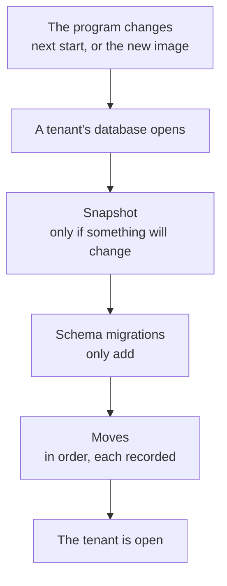

# Plan: updates, moves and going back

Status: concept, written on 2026-11-14. Nothing of it is built. Checked against `main` at
`2e18ecad`. Related: `docs/plans/definition-versions.md` (a definition's version),
`docs/plans/run-connections.md` (its kept accounts are the first move).

## In short

An update does three things, in this order, by itself:

| | What | Today | With this plan |
|---|---|---|---|
| 1 | The program changes | Built: versions side by side on a computer, an image tag in the cloud | As today |
| 2 | The schema changes | Built: migrations run when a database opens, forward only | Changes only add; taking away waits one release |
| 3 | The data moves | One-offs, each its own way; nothing records which ran | One list of moves, each with `up` and `down`, recorded per tenant |

Going back has two ways. A **snapshot** taken before the update brings everything back as it
was. A **reversible** update keeps what was written since: the schema only added, and each move
knows its way back.

There are no installs in the wild yet (2026-11-14). This is built before they come.

## What is built

| Piece | Where | How it runs | Back |
|---|---|---|---|
| The program on a computer | `cli/versions.ts`, `cli/autoupdate.ts` | A new version installs beside the one that runs and becomes `current` at the next start. The one before stays in `runtime/<version>/` | The folder is there; no command switches back |
| The program in the cloud | `compose.cloud.yaml`, `IMAGE_TAG` | The release's tag deploys the image | Set the tag back by hand |
| Schema of a tenant | `db/migrations/tenant` (76), `openTenantNow` in `db/client.ts` | When the tenant's database opens | None |
| Schema of the control database | `db/migrations/control` (17), `migrateControlDb` | At start | None |
| A plugin's tables | `migratePlugins`, through `onTenantOpen` | When the tenant's database opens | None |
| Tenant settings out of the control database | `moveTenantSettings` in `db/client.ts` | When the tenant's database opens | None |
| Kept accounts become connections | `db/kept-accounts.ts` | When the tenant's database opens | None |
| Files to where 0.16 keeps them | `cli/move-files.ts` | At start, and as `wizards move-files` | None |
| The Sources plugin's folders become mounts | `cli/move-folder-sources.ts` | Command only | None |
| Definitions to format v1 | `apps/runtime/scripts/definition-v1.mjs` | A script, run by hand | None |

- **Where the data is.** On a computer: `DATA_DIR/control.db` and `DATA_DIR/tenants/local.db`. In
  the cloud: the control database on Turso, the tenants' databases as files under
  `/data/tenants/<id>.db` on the VPS volume (`docs/plans/tenant-sync.md`). Files are blobs kept by
  their content.
- **An older program on a newer schema** already opens: drizzle runs only migrations newer than
  the last one applied, so a program that knows fewer runs none.
- **Nothing takes a copy** before an update.

## The system

### An update

### Moves

- **One list.** `apps/runtime/src/db/moves/`, one file per move: an id, the version it came
  with, `up`, and `down` where there is a way back. A move without one says why (`oneWay`).
- **Recorded.** A table `data_move` in each tenant's database holds the moves that ran, with when
  and under which version. The control database has its own list and table.
- **When.** After the schema migrations, when the database opens. Each move is one transaction
  and safe to start twice: two processes of the cloud open the same tenant.
- **A move that fails** leaves its data as it was. See open question 1 for what the tenant does
  then.
- **What becomes a move.** The one-offs of the table above: kept accounts, tenant settings,
  `move-files`, `move-folder-sources`. Their commands go once they are moves.
- **Definitions.** A change of the format is a move over the stored definitions (drafts,
  published versions). The same function upgrades an older `.wizard` file on import, which is
  "Import by version" in `definition-versions.md`: one chain of steps, used by both.
- **Plugins** bring moves of their own in the same shape. Later.

### Going back

| | Snapshot | Reversible |
|---|---|---|
| How | Restore the copy taken before the update, start the version before | Start the version before; the moves newer than it run their `down`, newest first |
| Keeps what was written since | No | Yes |
| Needs | A copy before every update that changes something | Schema changes that only add, and a tested `down` per move |
| Good for | An update that went wrong at once | Going back days later |

**Snapshot.**

- Before the first migration or move of an update, the database is copied to
  `DATA_DIR/snapshots/<tenant>/<version before>.db`. A database nothing changes in gets no copy.
- The copy must be consistent while the database is in use. `VACUUM INTO` does that for a file;
  to be tried with libSQL.
- Blobs are not copied. They are kept by their content, so a snapshot stays whole as long as no
  blob is cleaned up while a snapshot may still name it.
- The control database on Turso is restored with Turso's own point-in-time restore. The tenants'
  databases get the same once they are on Turso.

**Reversible.**

- A schema migration only adds: a table, an index, a column that is nullable or has a default.
  Dropping or renaming lands one release later, once nobody goes back to the version that read it.
- A check in CI reads the migrations since the last release and fails on `DROP`, `RENAME` and a
  `NOT NULL` column without a default.
- A move's `down` puts the data back where the version before reads it. The record in
  `data_move` goes with it.

**The command.** `wizards downgrade` on a computer: it stops engenty wizards, says what was
written since the update (runs, wizards changed), and asks: keep it (the moves run back) or
restore the snapshot. Then it makes the version before `current` and starts it. In the cloud the
same runs inside the image before the tag is set back.

### What a release says

- `pnpm release` lists the moves and migrations since the last release, and for each move
  whether it has a way back.
- A release with a move that is `oneWay` says so in its notes: going back needs the snapshot.

## Order of work

| | Step | Where |
|---|---|---|
| 1 | The list of moves and `data_move`. The kept accounts are its first entry, behaving as today | `db/moves/`, `db/client.ts`, `db/kept-accounts.ts` |
| 2 | The snapshot before an update, how many are kept, `wizards status` names them | `db/client.ts`, `cli/` |
| 3 | `wizards downgrade` on a computer: the version before and the snapshot | `cli/versions.ts`, `cli/` |
| 4 | `down` for moves, the check for additive migrations in CI, a downgrade that keeps the data | `db/moves/`, `scripts/`, `.github/workflows` |
| 5 | The older one-offs become moves; their commands go | `cli/move-files.ts`, `cli/move-folder-sources.ts`, `db/client.ts` |
| 6 | A format change as a move, and the same chain on import | `packages/shared/src/definition.ts`, `definition-versions.md` |
| 7 | The cloud: the command in the image, and the steps written down | `compose.cloud.yaml`, `docs/development.md` |
| 8 | A plugin's own moves | `plugins/loader.ts` |

## For connections

- The kept accounts' move gets a `down`: a chosen connection goes back into the wizard's store.
- Step 5 of `run-connections.md` (the field kind `connection` and `spaceConnection` leave a
  definition) is a move over the definitions, with a `down`, not a script.

## Open questions

1. **A move fails: does the tenant open?** The kept accounts' move lets it open and tries again
   at the next start. A move the new program depends on (a format change) cannot. Recommendation:
   one rule, the tenant stays closed and shows under the failing tenants, as with a failed
   migration; the snapshot and the version before are the way out.
2. **How many snapshots stay?** Recommendation: the last two updates, at most 14 days.
3. **How far back?** Recommendation: one release, the one a computer keeps beside the current
   one. Further back only through a snapshot.
4. **Who goes back in the cloud?** Recommendation: engenty's platform admins, for all tenants at
   once. One tenant restored on its own is a later question.
5. **The moves' ids.** Recommendation: a date and a name (`2026-11-14-kept-accounts`), so the
   order reads from the folder.

## Not in this plan

- **Backups against loss** (a second place, a schedule). A snapshot lives beside the database.
- **Two-way sync of a tenant** between a computer and the cloud: `docs/plans/tenant-sync.md`.
- **Versions of templates and packages** in the marketplace.
